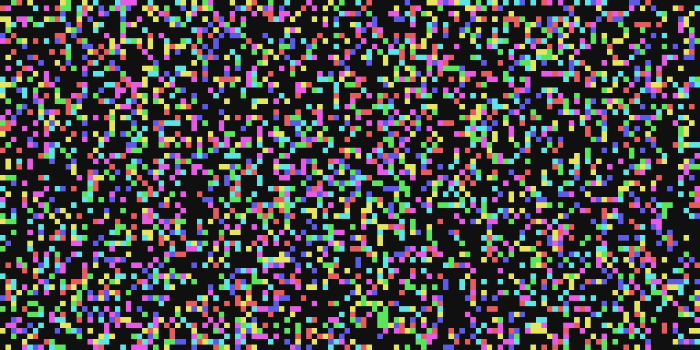

# Colorful Game of Life


An interactive, multi-faction extension of Conway's Game of Life built with Python, Pygame, NumPy, and Tkinter. In addition to desktop use, this program has also been optimized for live streaming and is suitable for overlaying on the screen.

## Overview

**Colorful Game of Life** reimagines John Conway's classic cellular automaton by adding **faction competition and territory control**. While cell survival and birth strictly adhere to standard Conway rules ($2$ or $3$ neighbors to survive, $3$ to reproduce), each cell belongs to a specific faction represented by vibrant HSV color palettes.

When new cells are born or surrounding territories change, neighboring factions compete for dominance based on local majority voting.



## Features

- **Multi-Faction Competition:** Watch multiple colored factions battle for territorial dominance across the board.
- **Classic Conway Mechanics:** Preserves standard Game of Life rules for reproduction, underpopulation, and overpopulation.
- **Interactive Painting:** Draw new cells with specific faction colors or erase existing cells in real time when paused.
- **Loop & Stagnation Detection:** 
  - **AutoReset:** Automatically generates a new random grid when an infinite loop or static state is detected.
  - **AutoPause:** Pauses the simulation automatically upon loop detection.
- **Dynamic Configuration:** Adjust grid dimensions, number of factions ($1$ to $24$), simulation speed (FPS), and display scaling on the fly via pop-up GUI dialogs.
- **Optimized Performance:** Vectorized array operations powered by `NumPy` for smooth rendering and fast logic execution. On a 256x256 grid with 24 factions, it uses only a few dozen MB of memory with low CPU usage, allowing it to run smoothly and consistently.

## How It Works

1. **Life & Death (Conway Rules):**
   - Any live cell with fewer than two live neighbors dies (underpopulation).
   - Any live cell with two or three live neighbors lives on to the next generation.
   - Any live cell with more than three live neighbors dies (overpopulation).
   - Any dead cell with exactly three live neighbors becomes a live cell (reproduction).

2. **Faction Inheritence & Territorial Control:**
   - For every surviving or newly born cell, neighboring cells cast votes based on their faction IDs.
   - The faction with the highest neighbor count claims the cell.
   - Tie-breaking is resolved using small random noise to ensure dynamic territory shifts.

## Prerequisites

- **Python 3.10 or higher** (Uses Python 3.10+ `match-case` syntax)
- Required Python libraries:
  - `pygame`
  - `numpy`
  - `tkinter` (usually bundled with standard Python distributions)

## Getting Started

### 1. Clone the repository
```bash
git clone https://github.com/francucelo/colorful-game-of-life.git
cd colorful-game-of-life
```
Or download directly `colorful_game_of_life.py`.

### 2. Install dependencies
```bash
pip install pygame numpy
```

### 3. Run the application
```bash
python colorful_game_of_life.py
```

## Controls & Keybindings

| Key / Input | Action |
| :--- | :--- |
| **`Space`** | Toggle Pause / Resume simulation |
| **`Enter`** | Advance to the next generation manually (when paused) |
| **`Mouse Left Click`** | Spawn cell with selected faction color |
| **`Mouse Right Click`** | Erase cell |
| **`1` – `9`** | Select brush faction ($1$ to $9$) |
| **`0`** / **`NumPad 0`** | Select random faction brush |
| **`Z`** | Open dialog to select specific faction brush ID |
| **`A`** | Toggle **AutoReset** on loop detection |
| **`Q`** | Toggle **AutoPause** on loop detection |
| **`C`** | Clear grid |
| **`R`** | Generate a new random grid |
| **`F`** | Change FPS limit ($0$ = unlimited) |
| **`S`** | Change grid size (Width $\times$ Height) |
| **`Y`** | Change number of active factions ($1$ to $24$) |
| **`P`** | Save screenshot (`screenshot.png`) |
| **`W`** | Toggle window display scaling (`SCALED` mode) |
| **`H`** | Show help dialog |
| **`I`** | Display current simulation info |

## Insert into the live stream screen

To insert this program into a live stream or recording, simply follow these steps:

- Press `W` to switch the window to unscaled mode so it can be adjusted in the streaming software.
- Minimize the window, then select it in the streaming software to insert it.
- Set the scaling algorithm for this window in the streaming software to "Nearest Neighbor".

## License

This project is open-source and available under the [MIT License](LICENSE).
